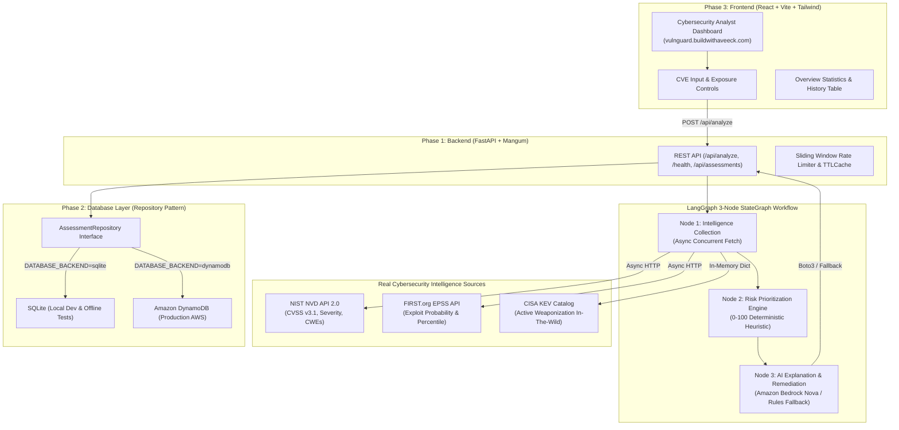

# VulnGuard AI — AI-Powered CVE Intelligence & Vulnerability Prioritization Platform

[](https://www.python.org/)
[](https://fastapi.tiangolo.com/)
[](https://github.com/langchain-ai/langgraph)
[](https://aws.amazon.com/bedrock/)
[](https://aws.amazon.com/dynamodb/)
[](https://vitejs.dev/)
[](https://opensource.org/licenses/MIT)

> **VulnGuard AI** is a production-grade cybersecurity triage platform designed for security analysts and SecOps teams. It automates vulnerability investigations across three real threat intelligence feeds (NIST NVD, FIRST EPSS, CISA KEV), computes a deterministic 0–100 risk prioritization score factoring in asset context and exposure, and synthesizes evidence-grounded AI remediation roadmaps using Amazon Bedrock Nova models with automated fallback to deterministic rules.

---

## Architecture Overview



---

## Core Capabilities

### 1. Multi-Source Real Threat Intelligence
- **NIST National Vulnerability Database (NVD API 2.0):** Ingests official descriptions, CVSS v3.1 metrics, CWE IDs, published dates, and advisory links. Supports keyless rate limits (5 req/30s) or authenticated limits (50 req/30s with `NVD_API_KEY`) with exponential backoff and jitter. Cached for 12 hours.
- **FIRST Exploit Prediction Scoring System (EPSS):** Queries per-CVE exploitation probabilities (e.g., 97.5%) and percentile rankings (e.g., 99.9th percentile) with 24-hour caching.
- **CISA Known Exploited Vulnerabilities (KEV) Catalog:** Ingests the full federal catalog (~1,800 active exploits) into an in-memory dictionary for $O(1)$ lookups with a 6-hour refresh TTL. **Distinguishes confirmed negative findings from unknown/missing data.**

### 2. Deterministic Risk Prioritization Scoring (0–100)
A custom cybersecurity portfolio heuristic combining five normalized factors:

$$\text{Composite Score} = (0.30 \times \text{CVSS}) + (0.30 \times \text{EPSS}) + (0.20 \times \text{KEV}) + (0.10 \times \text{Criticality}) + (0.10 \times \text{Exposure})$$

| Component | Weight | Input Normalization Scale |
|---|---|---|
| **CVSS Base Severity** | 30% | CVSS (0.0 to 10.0) $\times 10 \rightarrow 0 \text{ to } 100$ |
| **EPSS Probability** | 30% | EPSS probability ($0.0 \text{ to } 1.0$) $\times 100 \rightarrow 0 \text{ to } 100$ *(Percentile displayed separately)* |
| **CISA KEV Status** | 20% | Active in KEV: $100 \text{ pts}$, Confirmed Negative: $0 \text{ pts}$, Unknown: $30 \text{ pts}$ |
| **Asset Criticality** | 10% | Critical: $100$, High: $70$, Medium: $40$, Low: $10$ |
| **Perimeter Exposure** | 10% | Public Facing: $100$, Internal / Isolated: $30$ |

#### Priority Classifications
- **CRITICAL:** $85 \text{ to } 100$ (Immediate emergency SLA; active weaponization or critical remote exploit)
- **HIGH:** $70 \text{ to } 84$ (Substantial operational risk; remediation within current sprint)
- **MEDIUM:** $40 \text{ to } 69$ (Standard maintenance patching cadence)
- **LOW:** $0 \text{ to } 39$ (Minimal exposure or theoretical threat)

> **Provisional Assessments:** If upstream CVSS or EPSS data is pending or unavailable, assessments are explicitly flagged as `is_provisional = true` with itemized explanations.

### 3. Amazon Bedrock Nova AI & Deterministic Fallback
- Invokes Amazon Bedrock Nova (`amazon.nova-lite-v1:0` or configured model) with strict evidence grounding.
- Produces: Executive Summary for CISOs, Technical Vulnerability Mechanics, In-The-Wild Exploitation Assessment, Prioritized Patching Checklist, and Compensating Controls / Mitigations.
- **Fail-Safe Guarantee:** If Bedrock is unreachable or credentials are not supplied, the platform automatically generates an evidence-grounded deterministic explanation labeled as `deterministic-fallback-rules`.

### 4. Dual-Backend Repository Persistence
- **Production:** Amazon DynamoDB via Boto3 with On-Demand billing, KMS encryption, and Global Secondary Indexes (`HistoryIndex` and `CveIndex`). Automatically converts numerical data to `Decimal`.
- **Local Development:** Standard library SQLite with zero external dependencies.
- **Fail-Fast Safety:** Selected via `DATABASE_BACKEND=sqlite` or `DATABASE_BACKEND=dynamodb`. The application **never** silently falls back to SQLite if DynamoDB fails in production.

---

## Project Structure

```
Valuguard/
├── backend/
│   ├── app/
│   │   ├── __init__.py
│   │   └── main.py                # FastAPI app, CORS, error handlers, Mangum handler
│   ├── api/
│   │   ├── __init__.py
│   │   ├── routes.py              # /analyze, /assessments/{id}, /assessments, /health
│   │   └── deps.py                # Dependency injection for repositories
│   ├── agents/
│   │   ├── state.py               # LangGraph TypedDict state
│   │   ├── graph.py               # 3-Node LangGraph StateGraph pipeline
│   │   ├── bedrock.py             # Amazon Bedrock Nova & deterministic fallback
│   │   └── nodes/                 # Intelligence, Prioritization, Explanation nodes
│   ├── services/
│   │   ├── nvd_service.py         # NIST NVD 2.0 client & rate limiter
│   │   ├── epss_service.py        # FIRST.org EPSS client
│   │   ├── cisa_service.py        # CISA KEV catalog parser & cache
│   │   ├── scorer.py              # Deterministic 0-100 scoring engine
│   │   ├── cache.py               # In-memory thread-safe TTL cache
│   │   └── rate_limiter.py        # Sliding window & exponential backoff with jitter
│   ├── schemas/                   # Pydantic v2 domain schemas (risk, intel, assessment)
│   ├── core/                      # Settings, structured logging, domain exceptions
│   ├── tests/                     # Pytest suite (19 tests covering all components)
│   └── requirements.txt
├── database/
│   ├── interface.py               # AssessmentRepository abstract base class
│   ├── sqlite_repo.py             # Zero-dependency local SQLite repository
│   ├── dynamodb_repo.py           # Amazon DynamoDB Boto3 repository & Decimal serializer
│   ├── factory.py                 # Explicit backend factory selector
│   ├── schemas/                   # Declarative table definitions JSON & creation helpers
│   └── infrastructure/            # AWS SAM template.yaml & IAM policies
├── frontend/
│   ├── src/
│   │   ├── components/            # Header, Sidebar, Search, Gauges, Recharts, AI Panel
│   │   ├── api/client.ts          # Reusable typed API client
│   │   ├── types/                 # TypeScript interfaces matching backend models
│   │   └── App.tsx                # Main stateful dashboard
│   ├── index.html
│   ├── vite.config.ts
│   ├── tailwind.config.js
│   ├── vercel.json                # Vercel deployment & security headers
│   └── package.json
├── .env.example
└── README.md
```

---

## Local Installation & Quickstart

### Prerequisites
- Python 3.12+ (Python 3.14 compatible)
- Node.js 18+ and npm
- AWS CLI (optional, required only for live Amazon Bedrock Nova / DynamoDB)

### 1. Backend Setup
```powershell
# 1. Install backend dependencies
python -m pip install -r backend/requirements.txt

# 2. Configure environment
Copy-Item backend/.env.example backend/.env

# 3. Start FastAPI server (runs on http://localhost:8000)
python -m uvicorn backend.app.main:app --reload --port 8000
```

Verify backend health at: [http://localhost:8000/health](http://localhost:8000/health)  
Interactive Swagger API documentation: [http://localhost:8000/docs](http://localhost:8000/docs)

### 2. Frontend Setup
```powershell
# In a new terminal window:
cd frontend

# 1. Install frontend packages
npm install

# 2. Start Vite development server (runs on http://localhost:5173)
npm run dev
```

Open [http://localhost:5173](http://localhost:5173) in your browser.

---

## Testing & Verification

The test suite includes 19 comprehensive unit and integration tests covering rate limits, caching, scoring heuristics, LangGraph workflow execution, SQLite/DynamoDB persistence, and FastAPI REST endpoints.

```powershell
# Run all tests
python -m pytest backend/tests -v
```

### Test Coverage Highlights
- `test_api.py`: Validates `/health`, `/api/analyze`, `/api/assessments/{id}`, `/api/assessments`, input validation errors (HTTP 422 for malformed CVEs), and 404 handling.
- `test_graph.py`: Executes the 3-node LangGraph StateGraph pipeline end-to-end.
- `test_scorer.py`: Tests priority boundaries (Critical, High, Medium, Low), proves that EPSS probability (not percentile) is used in scoring, and checks provisional flag mechanics.
- `test_intelligence.py`: Tests NVD parsing, EPSS ingestion, CISA KEV catalog lookup, and TTL cache expiration.
- `test_persistence.py`: Proves assessment save/retrieval in SQLite and verifies DynamoDB Boto3 Decimal serialization.

---

## Production Deployment Guide

### 1. Frontend Deployment (Vercel & Cloudflare DNS)
1. **Push code to GitHub repository.**
2. **Import repository into [Vercel](https://vercel.com/):**
   - **Framework Preset:** Vite
   - **Root Directory:** `frontend`
   - **Build Command:** `npm run build`
   - **Output Directory:** `dist`
   - **Environment Variables:** Set `VITE_API_BASE_URL` to your production API Gateway URL (e.g., `https://api.vulnguard.buildwithaveeck.com`).
3. **Configure Custom Domain in Vercel:**
   - Add domain: `vulnguard.buildwithaveeck.com`.
4. **Cloudflare DNS Configuration:**
   - Log into Cloudflare Dashboard for `buildwithaveeck.com`.
   - Add a DNS record:
     - **Type:** `CNAME`
     - **Name:** `vulnguard`
     - **Target:** `cname.vercel-dns.com`
     - **Proxy status:** Proxied (Orange Cloud enabled for DDoS & WAF protection) or DNS-Only during initial SSL validation.
     - **SSL/TLS Mode:** Full (Strict).

### 2. Backend Serverless Deployment (AWS SAM / Lambda / API Gateway)
The backend is packaged with **Mangum** for AWS Lambda serverless execution:

```powershell
# Build Linux-compatible Lambda dependencies and source from the tracked repository
.\scripts\prepare_lambda.ps1
sam deploy --template-file database/infrastructure/template.yaml --stack-name vulnguard-ai-backend --region us-east-1 --resolve-s3 --capabilities CAPABILITY_IAM
```
SAM provisions:
- AWS Lambda function running `backend.app.main.handler` with Python 3.12 runtime.
- API Gateway HTTP API v2 with CORS configured for `https://vulnguard.buildwithaveeck.com`.
- Uses the existing Amazon DynamoDB table `VulnGuardAssessments`. Provision `UserHistoryIndex` and `UserCveHistoryIndex` using `scripts/update_dynamodb_indexes.py` before switching traffic to user workspaces.
- IAM Role granting least-privilege access to DynamoDB and `bedrock:InvokeModel` on Nova models.
- Cognito user pool, public SPA client, and hosted sign-in domain. Copy the stack outputs into the frontend build variables `VITE_COGNITO_DOMAIN` and `VITE_COGNITO_CLIENT_ID`.

---

## API Reference

| Method | Endpoint | Description |
|---|---|---|
| `GET` | `/health` | Service health status and database backend indicator |
| `POST` | `/api/analyze` | Executes LangGraph triage pipeline, calculates risk score, and saves assessment |
| `GET` | `/api/assessments/{id}` | Retrieves completed assessment by ID from repository |
| `GET` | `/api/assessments?limit=20` | Returns chronological history of triaged assessments |
| `GET` | `/api/threat-intel/status` | Returns cache statistics and KEV catalog status |

### Sample Request: `POST /api/analyze`
```json
{
  "cve_id": "CVE-2021-44228",
  "asset_criticality": "CRITICAL",
  "internet_exposure": "PUBLIC_FACING",
  "system_context": "Production API Gateway on AWS ECS",
  "simulate_offline": false
}
```

---

## Security & Compliance Notice
- **Zero Exposed Secrets:** API keys and AWS credentials are never exposed in frontend code or Git repositories.
- **Custom Risk Heuristic:** VulnGuard AI uses a deterministic prioritization model designed for portfolio risk scoring, not as a replacement for official regulatory mandates.
- **License:** Licensed under the MIT License.
